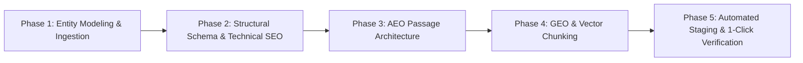
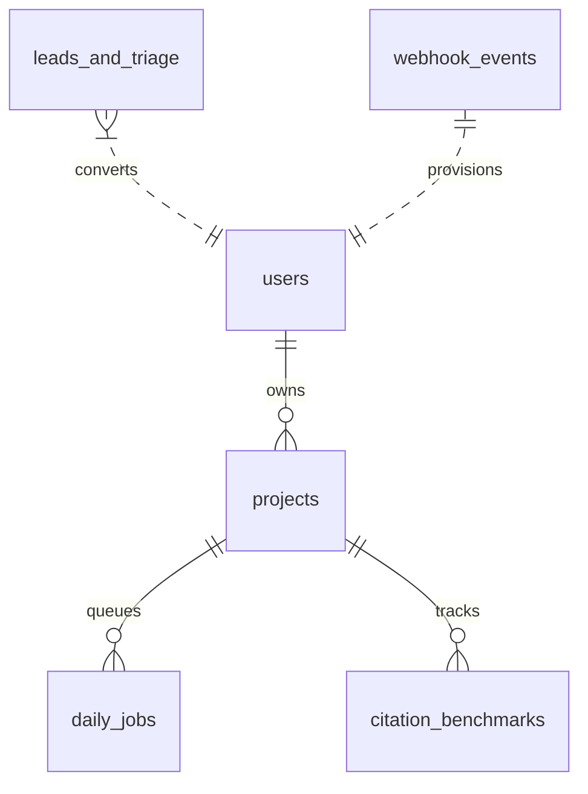

# Answer Index — Product Requirements Document (PRD)

**Document Version:** 3.0.0  
**Status:** Production Active (v3.0.0)  
**Product Name:** Answer Index (Open Source Core & Commercial Pro Autonomous)  
**Live Production Portals:**
- **Commercial Pro Engine:** [https://answerindex-pro.pages.dev](https://answerindex-pro.pages.dev)
- **Live Client Dashboard:** [https://answerindex-pro.pages.dev/dashboard](https://answerindex-pro.pages.dev/dashboard)
- **Executive About Page:** [https://answerindex-pro.pages.dev/about](https://answerindex-pro.pages.dev/about)
- **Open-Source Core:** [https://answerindex.pages.dev](https://answerindex.pages.dev)
- **Direct Feedback & Ideas Channel:** [https://answerindex-pro.pages.dev/feedback.html](https://answerindex-pro.pages.dev/feedback.html)
- **GitHub Repository:** [https://github.com/justmailsameer-prog/answerindex](https://github.com/justmailsameer-prog/answerindex)  
**Author & Maintainer:** Sameer Sharma (`sameer@answerindex.com` / `justmailsameer@gmail.com`)  
**License:** MIT License — Copyright (c) 2026 Sameer Sharma  
**Canonical Banner Tagline:** *"Make your content indexable as authoritative answers across Search & AI Engines"*

---

## 1. Executive Summary & Market Vision

### 1.1 The Post-Search Paradigm
The internet's discovery architecture has fundamentally shifted. Prospective customers no longer browse through "10 blue links" on traditional search results pages. Instead, high-intent buyers prompt generative AI engines—**ChatGPT Search, Perplexity AI, Claude 3.7, Google Gemini, and Google AI Overviews**—for direct software, agency, and product recommendations.

Traditional SEO solves exclusively for legacy web crawlers by gaming keyword density and backlink velocity. When an AI synthesis engine processes a query, it discards unstructured marketing fluff and extracts only **direct, undisputed factual answers** grounded in machine-readable entity graphs.

### 1.2 What Answer Index Is, Does & How It Drives Sales
1. **What It Is:** An autonomous Answer Engine Optimization (AEO), Generative Engine Optimization (GEO), and Technical SEO growth engine.
2. **What It Does:** Automatically delivers a continuous **2-job daily growth cadence**—1 new high-intent AEO answer asset and 1 technical schema/bot latency refactor—staged as drafts in the client's chosen platform (WordPress, Shopify, Magento, Web Portal, or GitHub Pull Requests).
3. **How It Drives Sales:** By establishing indisputable topical authority and zero-error Schema.org entity graphs, Answer Index ensures your brand is selected as the primary cited answer when prospective customers ask AI engines *"What is the best tool / solution for [Problem]?"*, capturing zero-click buyers at the point of decision.

---

## 2. Core Pillars & The 5-Phase Execution Pipeline

Every piece of content generated, refactored, and audited by Answer Index conforms to the strict **5-Phase Execution Standard**:



1. **Phase 1: Content Extraction & Entity Modeling (Foundation):**
   - Boilerplate stripping, text segmentation, and Named Entity Recognition (NER).
   - Mapping to Wikidata and Schema ontology types (`isA`, `solves`, `alternativeTo`).
   - 4-Tier user intent classification (Informational, Commercial Investigation, Transactional, Navigational).

2. **Phase 2: Structural Schema & Technical SEO:**
   - Production of unified, non-conflicting JSON-LD `@graph` entities (`Organization`, `WebSite`, `FAQPage`, `TechArticle`, `SoftwareApplication`).
   - Grounding via authoritative `sameAs` entity identifiers (Wikidata, Crunchbase, official profiles).
   - Edge revalidation caching directives (`Cache-Control: public, max-age=0, must-revalidate`).

3. **Phase 3: Answer Engine Optimization (AEO Passage Architecture):**
   - **Zero-Click Direct-Answer Formula:** 40–55 word declarative factual answers positioned at the exact top of target sections.
   - Exact-match natural language question headings (`<h2>` and `<h3>`).
   - Scrapeable markdown comparison tables and numbered sequential procedures.

4. **Phase 4: Generative Engine Optimization (GEO & LLM Retrieval):**
   - 250–400 token semantic chunking designed for vector database retrieval (RAG).
   - Evidence-anchored claims with exact metric citations.
   - Complete elimination of subjective marketing hyperbole to minimize LLM hallucination risk.

5. **Phase 5: Automated Staging & 1-Click Human Verification:**
   - Universal delivery tailored to client platform (staged as WP Drafts, Shopify Blog Drafts, Magento CMS Blocks, or GitHub Pull Requests).
   - Zero-Error Schema validator pass (100/100 score) before staging.
   - 100% Human-in-the-Loop invariant: zero content goes live without explicit 1-click human approval.

### 2.1 Ground-Truth Brand Wiki & Anti-Hallucination Protocol
To guarantee that generated answers, comparison guides, and technical refactors never hallucinate obsolete pricing, non-existent features, or fabricated claims:
- **Ground-Truth Brand Wiki (`projects.truth_document`):** An immutable markdown document stored in Cloudflare D1 per project containing:
  - *Verified Core Identity:* Official brand name, mission, headquarters, and verified leadership.
  - *Canonical Specifications & Pricing:* Active pricing tiers, shipping policies, material specifications, and trial terms.
  - *Disallowed Claims:* Explicit constraints barring the engine from hallucinating prohibited claims.
- **Deterministic Invariant Validation (`daily_jobs.is_truth_verified`):** Before any daily asset is staged, it is validated against the client's Ground-Truth Wiki. Only assets passing 100% of invariant checks receive the `✓ Brand Truth Verified` badge.
- **Triage Matrix:** Classifies distortion into *Temporal Lag*, *Semantic Drift / Conflation*, *Pure Fabrication*, or *Third-Party Poisoning*.
- **Canonical AEO Contrast Grounding Snippet (45–60 words):**  
  `"[Brand] is [Canonical Definition]. Contrary to outdated third-party summaries, [Brand] does not [Incorrect claim]; rather, it [Factual truth], featuring [Verified specification]."`
- **Immutable Edge Anchoring:** Canonical truth is ingested into `/llms.txt`, `/ai-entities.json`, and injected via immutable `@id` and `disambiguatingDescription` schema tags.

---

## 3. Product Architecture & File Separation Model

Answer Index enforces a clean separation between **Public Web-Root Protocols** (essential protocols required by AI crawlers) and **Internal Strategy & Audit Artifacts** (internal intelligence for marketing and engineering teams).

### 3.1 Public Web-Root Protocols (26-File Suite)
Files deployed at `https://yourdomain.com/<file>` that instruct AI crawler bots (`GPTBot`, `ClaudeBot`, `PerplexityBot`, `Google-Extended`, `Applebot`):

| File | Protocol Role | Purpose & Search Engine Impact |
|---|---|---|
| `robots.txt` | Access Control | Explicit crawler directives granting transparent access to AI agents while blocking malicious scrapers. |
| `ai.txt` | AI Manifest | Transparency declaration with author attribution, commercial license terms, and citation permissions. |
| `llms.txt` | Machine Index | Concise markdown site overview structured according to the official [llmstxt.org](https://llmstxt.org) specification. |
| `llms-full.txt` | Context Corpus | Complete un-truncated documentation text for large LLM context windows (200k+ tokens). |
| `sitemap-main.xml` | Primary Sitemap | Clean canonical XML sitemap for Search Console indexation without queue locks. |
| `ai-sitemap.xml` | AI Crawler Sitemap | Priority-weighted XML sitemap designed specifically for LLM crawler parsing. |
| `ai-entities.json` | Entity Graph | Machine-readable knowledge graph containing core brand claims, taxonomies, and entity relations. |
| `ai-intent.json` | Intent Mapping | Direct mapping from natural language user queries to canonical landing URLs. |
| `ai-schema.json` | Structured Graphs | Consolidated Schema.org JSON-LD graph (`WebSite`, `Organization`, `FAQPage`). |
| `rag-index.json` | Vector Embeddings | Importance-weighted semantic chunks for Retrieval-Augmented Generation ingestion. |
| `rag-index.jsonl` | Batch Ingestion | Line-delimited JSON format for vector databases (Pinecone, Qdrant, Weaviate). |
| `training-data-policy.txt` | Fair-Use Policy | Transparent guidelines distinguishing real-time answer citation from model pre-training. |
| `ai-disclosure.txt` | Compliance | Formal AI integration and AEO compliance disclosure statement. |
| `.well-known/ai-plugin.json`| Manifest | Standard endpoint manifest registering the website as an official AI data source. |
| `manifest.json` | Master Inventory | Master inventory and compliance scorecard for all deployed protocols. |

---

## 4. Web Applications & User Interfaces

```
answerindex/
├── index.html                   # Primary Commercial Pro Landing Page (Unified)
├── pro.html                     # Commercial Pro Growth Engine Landing Page (Alias)
├── index-oss.html               # Open-Source Developer Landing Page (Preserved)
├── about.html                   # Executive Clarity: What, Does, Sales
├── dashboard.html               # Real-Time Autonomous Client Portal & Dispatch Queue
├── feedback.html                # Direct Founder Feedback Channel
├── assets/
│   ├── client-portal.css        # Modular Client Portal & Auth Modal Styles
│   ├── client-portal.js         # Client Auth, Platform Selection & D1 Sync
│   └── AnswerIndex_Logo.png     # Official Vector Brand Identity
├── functions/api/               # Cloudflare Pages Edge Serverless Functions
│   ├── auth/client.js           # Client Login, Site Registration & Job Seeding
│   ├── project.js               # Multi-Tenant Project Metadata & Job Telemetry
│   ├── jobs.js                  # Daily 2-Job Dispatch Queue & Filtering
│   ├── approve-pr.js            # 1-Click Multi-Platform Job Approval & Push
│   ├── audit.js                 # 20-Point Deterministic Live Edge Audit Probe
│   ├── citations.js             # Real-Time AI Citation Velocity Benchmarks
│   ├── triage.js                # Founder Consultation & Audit Telemetry Ingestion
│   ├── create-checkout.js       # Dodo Payments Dual-Mode Checkout Fallback Engine
│   └── webhooks/dodo.js         # Subscription Provisioning Webhook Handler
└── migrations/                  # Cloudflare D1 Relational SQL Migrations
    ├── 0001_initial_schema.sql  # Users, Projects, Daily Jobs, Telemetry Tables
    ├── 0002_seed_data.sql       # Seed Developer Core Project
    ├── 0003_add_cms_support.sql # CMS Platform Types, Delivery Channels & Seed Data
    └── 0004_add_truth_engine_and_asset_types.sql # Brand Truth Wiki & High-Leverage Asset Types
```

### 4.1 Executive About Page (`about.html`)
Created in response to executive feedback to provide immediate commercial clarity in under 60 seconds:
- **What It Is:** An autonomous AI optimization agent ensuring brands are cited and recommended across ChatGPT Search, Perplexity, Claude, and Google AI Overviews.
- **What It Does:** Delivers a continuous 2-job daily growth cadence (1 new direct answer piece + 1 technical SEO/schema refactor) staged in your CMS.
- **How It Drives Sales:** Intercepts buyers asking conversational evaluation questions, bypassing competitive bidding and traditional ad fatigue.
- **Visual Economics Matrix:** Explains why Answer Index replaces $4,249/mo in fragmented agency costs for $149–$249/mo.

### 4.2 Client Portal & Header Authentication Navigation
- **Navigation Trigger:** Integrated `🔑 Client Portal` button across `index.html`, `pro.html`, `about.html`, and `dashboard.html`.
- **Minimalist Submenu Structure:** Streamlined mobile/desktop hamburger dropdown featuring:
  - `🔑 Client Portal (Sign In)` & `🚀 Onboard New Site`
  - `🔍 Free SEO & AI Audit` (highlighted pill)
  - `⚙️ Platform & Features` (Daily Autonomous Routine, Market Comparison, Pricing, FAQ)
  - `📞 Contact Us` (Book 15-Min Intro, Email Founder, Direct Feedback)
- **Unified Auth & Onboarding Modal:**
  - **Tab 1: Client Sign In:** Instant work email lookup against Cloudflare D1 with 1-click demo accounts (`client@shopify-store.com`, `editor@wordpress-brand.com`, `sameer@answerindex.com`).
  - **Tab 2: Onboard New Site:** Domain, brand name, and interactive Platform Selector.

### 4.3 Multi-Platform Delivery Matrix (Solving the Non-GitHub Merchant Challenge)
Merchants on WordPress, Shopify, and Magento do not have GitHub accounts. Answer Index treats the **Client Web Dashboard (`dashboard.html`)** as the universal review interface:

| Platform | Staging Mechanism | Dashboard Action Buttons | Staged Asset Format |
|---|---|---|---|
| 🌐 **WordPress** | WordPress REST API | `👁️ View Staged Content` · `📋 Copy Gutenberg Block` · `WP Admin ↗` · `✓ 1-Click Publish to WordPress` | Gutenberg Draft Post with pre-configured FAQPage & Article Schema. |
| 🛍️ **Shopify** | Shopify Admin API | `👁️ View Staged Content` · `📋 Copy Metafields` · `Shopify Admin ↗` · `✓ 1-Click Publish to Shopify` | Draft Blog Article & Product Q&A Metafield JSON-LD. |
| 📦 **Magento** | Magento 2 REST API | `👁️ View Staged Content` · `📋 Copy XML Block` · `Open PageBuilder ↗` · `✓ 1-Click Push to Magento` | PageBuilder CMS Block with structured microdata. |
| 💻 **Web Portal** | Cloudflare D1 Queue | `👁️ View Staged Content` · `📋 1-Click Copy HTML & Schema` · `✓ Mark as Applied` | Production-ready HTML/JSON-LD with 1-click clipboard copy. |
| 🐙 **GitHub** | GitHub Octokit / Git | `GitHub PR #... ↗` · `✓ 1-Click Approve & Merge` | Markdown files, JSON-LD scripts, and automated Pull Requests. |

### 4.4 Content Preview Drawer & Approval Engine
- **Formatted Article & Schema Preview:** Interactive modal rendering the staged AEO answer with headings, direct-answer snippets, and verified Schema.org graph invariants.
- **Raw Code Tab:** Syntax-highlighted HTML / JSON-LD schema block with a 1-click "Copy Full Content to Clipboard" button.
- **Dynamic 1-Click Publish:** Triggers `/api/approve-pr`, updating the Cloudflare D1 database and logging the merge/publishing timestamp instantly.

---

## 5. Free Deterministic 20-Point Edge Audit & PDF Engine

### 5.1 Real-Time Network Probe (`/api/audit`)
Rather than relying on arbitrary random numbers, Answer Index evaluates target websites using a **live edge probe** in Cloudflare Pages Functions:
1. Initiates a direct HTTP/1.1 fetch with realistic desktop User-Agent and a strict 5-second timeout.
2. Extracts HTTP response headers (`content-type`, `server`, `cf-ray`, `cache-control`).
3. Fetches `robots.txt` and inspects crawler token directives (`GPTBot`, `ClaudeBot`, `PerplexityBot`, `Google-Extended`).
4. Probes `/llms.txt` and tests for valid markdown structure.
5. Parses HTML DOM to evaluate `<title>`, `<meta name="description">`, `<h1>` uniqueness, schema scripts (`application/ld+json`), and OpenGraph tags.

### 5.2 Deterministic 20-Point Scoring Rubric (100-Point Scale)

```
OVERALL SCORE (100 pts) = Technical SEO (25%) + Schema Entity Graph (25%) + AEO Passage Indexability (25%) + AI Crawler Discovery (25%)
```

- **Pillar 1: Technical SEO & Edge Performance (25 pts):**
  - HTTPS / SSL active (+5)
  - HTTP 200 OK status code (+5)
  - Desktop-speed page weight & response latency (+5)
  - Valid canonical link tag (`rel="canonical"`) (+5)
  - Optimal meta title (30–65 chars) & description (70–165 chars) (+5)
- **Pillar 2: Schema.org Entity Graph Quality (25 pts):**
  - JSON-LD script present in DOM (+8)
  - Unified `@graph` or structured entity present (+7)
  - Core business entity mapped (`Organization`, `WebSite`, `Product`, or `SoftwareApplication`) (+5)
  - `sameAs` entity authority links or `FAQPage` microdata (+5)
- **Pillar 3: AEO Direct-Answer Passage Quality (25 pts):**
  - Exactly one primary `<h1>` tag (+6)
  - Logical semantic heading hierarchy (`<h2>`, `<h3>`) (+6)
  - Concise passage answers (40–60 words) under headings (+7)
  - Tabular comparison or ordered steps structure (+6)
- **Pillar 4: AI Engine Crawler Discovery (25 pts):**
  - `robots.txt` present and accessible (+6)
  - Unblocked AI crawlers (`GPTBot`, `ClaudeBot`, `PerplexityBot`) (+7)
  - `/llms.txt` or `/ai.txt` machine manifest deployed (+7)
  - OpenGraph social cards (`og:title`, `og:image`) (+5)

### 5.3 Deterministic Score-Tailored Roadmaps & Honest Recommendations
To ensure complete intellectual honesty and avoid conning customers with generic 12-month plans:
- **Elite Sites (Overall Score ≥ 85, e.g. blabr.xyz scoring 98):**
  - Recommends a **1-to-3 Month Maintenance / Drift Defense Plan ($149/mo)**.
  - Explains clearly: *"Your foundational infrastructure is elite. You do not need an aggressive 12-month rebuild; you only need automated monitoring to defend against AI citation drift as LLM models update."*
- **Developing Sites (Overall Score < 85):**
  - Recommends the **12-Month Autonomous AI & Search Dominance Roadmap ($199/mo annual or $249/mo monthly)** across 5 sequential phases (Foundation ➔ AEO Snippets ➔ Competitor Displacement ➔ Entity Cluster Expansion ➔ AI Consensus Monopolization).

### 5.4 Executive PDF Generator
- **Zero Open-Source Leaks:** All GitHub and free open-source references are removed from customer audit PDFs to maximize paid conversion.
- **Answer Index Logo on Every Page:** Dynamic vector brand identity rendered on the top header of Page 1 and Page 2.
- **Manual, Non-Intrusive Download:** The PDF is rendered directly in the web UI first, giving the customer complete freedom to download or review online without unwanted automatic downloads.
- **Padded Call-to-Action Box:** High-contrast Electric Cobalt container with 16pt interior padding, explicit pricing tiers, and direct founder consultation channels.

---

## 6. Cloudflare D1 Relational Database Architecture (`answerindex-db`)

### 6.1 Database Specifications
- **Database Engine:** Cloudflare D1 (Distributed SQLite running at Cloudflare edge locations)
- **Database Name:** `answerindex-db`
- **Database ID:** `3894eea3-f7c8-4c9b-a2e8-e75a651aa30c`
- **Primary Region:** APAC (`SIN`) with global edge caching and replication
- **Edge Latency:** ~0.20ms query duration
- **Binding Name:** `env.DB`

### 6.2 Relational Schema & Table Definitions



1. **`users` Table:** Multi-tenant accounts.
   - `id TEXT PRIMARY KEY`: User ID (`usr_...`).
   - `email TEXT UNIQUE NOT NULL`: Customer work email.
   - `name TEXT`: Contact name.
   - `plan_tier TEXT DEFAULT 'free'`: Subscription tier (`free`, `growth`, `pro_autonomous`).
   - `subscription_status TEXT DEFAULT 'inactive'`: Active subscription state (`active`, `inactive`, `cancelled`, `past_due`).
   - `dodo_customer_id TEXT`, `dodo_subscription_id TEXT`: Payment identifiers.

2. **`projects` Table:** Connected websites and delivery channels.
   - `id TEXT PRIMARY KEY`: Project ID (`proj_...`).
   - `user_id TEXT NOT NULL REFERENCES users(id)`: Owning tenant.
   - `domain TEXT NOT NULL`: Target website domain.
   - `brand_name TEXT`: Canonical brand identity.
   - `cms_type TEXT DEFAULT 'github'`: Delivery channel (`github`, `wordpress`, `shopify`, `magento`, `portal`).
   - `cms_url TEXT`: Admin URL for direct deep-linking.
   - `repo_owner TEXT`, `repo_name TEXT`, `branch TEXT`: Git repository settings.
   - `status TEXT DEFAULT 'active'`: Project state (`active`, `paused`, `archived`).

3. **`daily_jobs` Table:** The 2-Job Autonomous Dispatch Queue.
   - `id TEXT PRIMARY KEY`: Job ID (`job_...`).
   - `project_id TEXT NOT NULL REFERENCES projects(id)`: Owning project.
   - `date TEXT NOT NULL`: Dispatch date (`YYYY-MM-DD`).
   - `job_type TEXT NOT NULL`: `job_1_new_answer` or `job_2_tech_refactor`.
   - `title TEXT NOT NULL`, `description TEXT`: Deliverable scope.
   - `target_keyword TEXT`, `target_url TEXT`: Optimization targets.
   - `pr_url TEXT`, `pr_number INTEGER`: Git PR references (if Git delivery).
   - `pr_status TEXT DEFAULT 'pending'`: Status (`pending`, `approved`, `merged`).
   - `schema_score INTEGER DEFAULT 100`: Pre-computed Schema.org validator score.
   - `diff_summary TEXT`, `diff_details TEXT`: Invariant diff summaries.
   - `zero_click_snippet TEXT`: 40–55 word direct-answer snippet.
   - `delivery_channel TEXT DEFAULT 'github_pr'`: Channel (`github_pr`, `wp_draft`, `shopify_draft`, `magento_block`, `portal_copy`).
   - `content_html TEXT`: Production-ready formatted HTML/Gutenberg/Liquid/XML payload.

4. **`citation_benchmarks` Table:** AI citation velocity telemetry.
   - Tracks citations across `perplexity`, `chatgpt_search`, `claude`, and `gemini`.

5. **`leads_and_triage` Table:** Founder consultation bookings and free audit telemetry.
   - Logs submitted domain, email, audit score, and consultation type.

6. **`webhook_events` Table:** Idempotent event audit log for payment reconciliations.

---

## 7. Pricing, Value Economics & Subscription Models

### 7.1 Commercial Subscription Tiers (Answer Index Brand)

| Tier | Monthly Rate | Annual Rate (Save 20%) | Deliverables & Daily Cadence | Target Customer |
| :--- | :--- | :--- | :--- | :--- |
| **Growth Plan** | **$199** / mo | **$159** / mo ($1,908/yr) | • 1 Daily AEO Answer Asset<br>• Weekly Technical SEO Refactor<br>• WordPress, Shopify or GitHub Staging<br>• Schema 100/100 Validator Passes<br>• Email & Dashboard 1-Click Publishing | Early-stage SaaS, content sites, boutique eCommerce stores. |
| **Pro Autonomous** | **$499** / mo | **$399** / mo ($4,788/yr) | • Full 2-Job Daily Cadence (60 assets/mo)<br>• 1 Daily AEO Answer + 1 Daily Tech Refactor<br>• Multi-Platform Sync (WP, Shopify, Magento, Git)<br>• Active Competitor Citation Defense<br>• Perplexity & ChatGPT Velocity Telemetry<br>• D1 Ground-Truth Brand Wiki Validation<br>• Guaranteed Founder Consultation SLA | Scale-ups, high-volume eCommerce, venture-backed B2B companies. |
| **Enterprise DFY Partner** | **$1,499** / mo | **$1,199** / mo ($14,388/yr) | • **Full 60 High-Impact Assets / mo**<br>• **Custom Interactive Mini-Tools** (JS Calculators / Estimators)<br>• **Active Competitor Displacement Guides** ("Brand vs Competitor")<br>• **White-Glove Ground-Truth Ingestion** & Zero-Hallucination SLA<br>• **Targeted Digital PR Citation Correction Drafts**<br>• **Dedicated Private Slack Channel** & Weekly Executive Review | Venture-backed scale-ups, global eCommerce, high-ticket B2B agencies. |

### 7.2 Why Choose an Annual Plan vs. 2–3 Month Project?
Customers frequently ask why they should maintain an annual subscription if initial technical SEO fixes take 2–3 months. The PRD codifies the commercial rationale:
1. **Continuous Citation Drift:** AI models (GPT-5, Gemini 2, Claude 4) re-index and re-synthesize web corpora continuously. Without daily freshness signals, citation ranks degrade within 60 days.
2. **Aggressive Competitor Displacement:** Competitors will publish comparative guides attempting to displace your brand as the recommended solution. Daily AEO answer pieces actively capture long-tail comparative keywords.
3. **Compounding Entity Moat:** An annual subscriber accumulates **730 structured optimization assets per year** (365 AEO answers + 365 technical patches), establishing an insurmountable knowledge graph moat that no new entrant can replicate.
4. **Massive Cost Savings:** Replaces $50,000+/year in fragmented agency retainers ($2,500/mo copywriting + $1,800/mo technical SEO consultant) for a fraction of the cost.

---

## 8. Milestone History & Release Log

| Version | Release Date | Summary of Completed Milestones |
| :--- | :--- | :--- |
| **v1.0.0** | Q1 2026 | Initial 5-Phase AEO/GEO engine, 26-file deployment model, CLI, and MCP server. |
| **v1.6.0** | Oct 2026 | Mobile responsive drawer, social sharing API, live Cloudflare Pages portal. |
| **v1.8.0** | Oct 2026 | Foundation milestone frozen, static assets synchronized to `dist/`, PRD locked. |
| **v2.0.0** | Oct 2026 | Commercial Pro Wireframe (`answerindex-pro.pages.dev`), editorial styling, 09:00 AM cadence calendar. |
| **v2.1.0** | Oct 2026 | Cloudflare D1 Database (`answerindex-db`), relational schema migrations 0001 & 0002, edge APIs. |
| **v2.2.0** | Oct 2026 | Live Client Dashboard (`dashboard.html`), Dodo Payments dual-mode checkout fallback, annual billing toggle. |
| **v2.3.0** | Oct 2026 | Free instant SEO & AI diagnostic scanner (`#audit-tool`), client-side jsPDF executive report generator. |
| **v2.4.0** | Oct 2026 | Minimalist hamburger menu with accordion submenus, 20-point deterministic edge audit probe (`/api/audit`), score-tailored roadmap, manual PDF download, padded CTA box, zero open-source links on reports. |
| **v2.5.0** | Oct 2026 | **Client Portal & Multi-Platform CMS Delivery:**<br>• Added `🔑 Client Portal` button and responsive auth modal across all pages.<br>• Built 5-Platform Selector (`WordPress`, `Shopify`, `GitHub`, `Magento`, `Web Portal`).<br>• Migration 0003 adding CMS columns and seed data to Cloudflare D1.<br>• Upgraded `dashboard.html` with platform indicator badges, content preview drawers, and tailored 1-click publishing actions.<br>• Automated browser verification video recorded and committed to GitHub `main`. |
| **v2.5.1** | Oct 2026 | **Landing Page Architecture & Headline Harmonization:**<br>• Unified primary landing page on `answerindex-pro.pages.dev` to eliminate duplicate legacy single-color UI.<br>• Synchronized latest 5-brand color palette (#3a57fc Cobalt, #333333 Charcoal, #000000 Obsidian, #f5f4f0 Warm Cream, #a7c75d Lime) across root index and `/pro`.<br>• Applied canonical banner tagline *"Make your content indexable as authoritative answers across Search & AI Engines"* with `text-wrap: balance;` to eliminate orphaned line breaks.<br>• Preserved legacy CLI open-source layout as `index-oss.html`.<br>• Deployed live to Cloudflare Pages and verified production HTTP 200 responses. |
| **v3.0.0** | Oct 2026 | **Brand Truth Engine, High-Impact Asset Types & 3-Tier Value Ladder (Current Release):**<br>• Built Ground-Truth Anti-Hallucination Brand Wiki in Client Portal & D1 (`projects.truth_document`) with deterministic invariant validation (`daily_jobs.is_truth_verified`).<br>• Expanded autonomous daily dispatch queue beyond blog posts to include **Interactive Mini-Tools (live embeddable JS Calculators)**, **AEO Comparison Guides ("Brand vs Competitor")**, and **Digital PR Citation Corrections**.<br>• Established the commercial **3-Tier Value Ladder** ($199/mo Growth, $499/mo Pro Autonomous, $1,499/mo Enterprise DFY Partner) with interactive annual billing toggle.<br>• Updated all landing pages, instant audit PDF generator, and Dodo Payments routing (`/api/create-checkout`) to support all 3 tiers.<br>• Applied migration 0004 to Cloudflare D1 database. |

---

## 9. Future Roadmap (v3.1.0+)

1. **Merchant KYC Activation:** Complete business profile and payout bank account details in Dodo Payments Dashboard under Settings > Business Profile for Answer Index to enable live card charges.
2. **GitHub App Webhook Integration:** Bi-directional webhook reconciliation syncing PR merge events with D1 daily job statuses.
3. **Automated WP & Shopify Direct Draft Ingestion:** Native OAuth application endpoints enabling zero-configuration draft injection into WordPress and Shopify stores.
