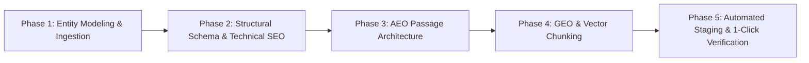

# Answer Index — Product Requirements Document (PRD)

**Document Version:** 5.6.0  
**Status:** Production Active (v5.6.0 — Enterprise Identity, Google/GitHub OAuth, Live Edge Delivery Engine & Sanitized Authentication Architecture)  
**Product Name:** Answer Index (Open Source Core & Commercial Pro Autonomous)  
**Live Production Portals & Protocols:**
- **Canonical Production Engine:** [https://answerindex.xyz](https://answerindex.xyz) & [https://www.answerindex.xyz](https://www.answerindex.xyz)
- **Commercial Pro Engine:** [https://answerindex.xyz/pro](https://answerindex.xyz/pro) (Mirror: [https://answerindex-pro.pages.dev](https://answerindex-pro.pages.dev))
- **Live Client Dashboard:** [https://answerindex.xyz/dashboard](https://answerindex.xyz/dashboard)
- **Executive About Page:** [https://answerindex.xyz/about](https://answerindex.xyz/about)
- **Architecture & How It Works:** [https://answerindex.xyz/how-it-works.html](https://answerindex.xyz/how-it-works.html)
- **Transparent Pricing Ladder:** [https://answerindex.xyz/pricing.html](https://answerindex.xyz/pricing.html)
- **Instant AI & SEO Scanner:** [https://answerindex.xyz/audit.html](https://answerindex.xyz/audit.html)
- **Standard AI Agent Index (`llms.txt`):** [https://answerindex.xyz/llms.txt](https://answerindex.xyz/llms.txt)
- **Comprehensive RAG Corpus (`llms-full.txt`):** [https://answerindex.xyz/llms-full.txt](https://answerindex.xyz/llms-full.txt)
- **AI-Priority XML Sitemap (`ai-sitemap.xml`):** [https://answerindex.xyz/ai-sitemap.xml](https://answerindex.xyz/ai-sitemap.xml)
- **Canonical Search Sitemap (`sitemap.xml`):** [https://answerindex.xyz/sitemap.xml](https://answerindex.xyz/sitemap.xml)
- **AI Crawler Directives (`robots.txt`):** [https://answerindex.xyz/robots.txt](https://answerindex.xyz/robots.txt)
- **Privacy Policy (GDPR/CCPA):** [https://answerindex.xyz/privacy.html](https://answerindex.xyz/privacy.html)
- **Terms of Service & Refund Policy:** [https://answerindex.xyz/terms.html](https://answerindex.xyz/terms.html)
- **Direct Feedback Channel:** [https://answerindex.xyz/feedback.html](https://answerindex.xyz/feedback.html)
- **GitHub Repository:** [https://github.com/justmailsameer-prog/answerindex](https://github.com/justmailsameer-prog/answerindex)  
**Author & Maintainer:** Sameer Sharma (`sameer@answerindex.xyz` / `justmailsameer@gmail.com`)  
**License:** MIT License — Copyright (c) 2026 Sameer Sharma  
**Canonical Banner Tagline:** *"Be the Answer AI Recommends"*

---

## 1. Executive Summary & Market Vision

### 1.1 The Post-Search Paradigm
The internet's discovery architecture has fundamentally shifted. Prospective customers no longer browse through "10 blue links" on traditional search results pages. Instead, high-intent buyers prompt generative AI engines—**ChatGPT Search, Perplexity AI, Claude 3.7, Google Gemini, and Google AI Overviews**—for direct software, agency, and product recommendations.

Traditional SEO solves exclusively for legacy web crawlers by gaming keyword density and backlink velocity. When an AI synthesis engine processes a query, it discards unstructured marketing fluff and extracts only **direct, undisputed factual answers** grounded in machine-readable entity graphs.

### 1.2 What Answer Index Is, Does & How It Drives Sales
1. **What It Is:** An autonomous Answer Engine Optimization (AEO), Generative Engine Optimization (GEO), and Technical SEO growth engine.
2. **What It Does:** Automatically delivers a continuous **2-job daily growth cadence**—1 new high-intent AEO answer asset and 1 technical schema/bot latency refactor—staged as drafts in the client's chosen platform (WordPress, Shopify, Magento, Web Portal, or GitHub Pull Requests).
3. **How It Drives Sales:** By establishing indisputable topical authority and zero-error Schema.org entity graphs, Answer Index ensures your brand is selected as the primary cited answer when prospective customers ask AI engines *"What is the best tool / solution for [Problem]?"*, capturing zero-click buyers at the point of decision.

---

## 2. Core Pillars & The 5-Phase Execution Pipeline

Every piece of content generated, refactored, and audited by Answer Index conforms to the strict **5-Phase Execution Standard**:



1. **Phase 1: Content Extraction & Entity Modeling (Foundation):**
   - Boilerplate stripping, text segmentation, and Named Entity Recognition (NER).
   - Mapping to Wikidata and Schema ontology types (`isA`, `solves`, `alternativeTo`).
   - 4-Tier user intent classification (Informational, Commercial Investigation, Transactional, Navigational).

2. **Phase 2: Structural Schema & Technical SEO:**
   - Production of unified, non-conflicting JSON-LD `@graph` entities (`Organization`, `WebSite`, `FAQPage`, `TechArticle`, `SoftwareApplication`).
   - Grounding via authoritative `sameAs` entity identifiers (Wikidata, Crunchbase, official profiles).
   - Edge revalidation caching directives (`Cache-Control: public, max-age=0, must-revalidate`).

3. **Phase 3: Answer Engine Optimization (AEO Passage Architecture):**
   - **Zero-Click Direct-Answer Formula:** 40–55 word declarative factual answers positioned at the exact top of target sections.
   - Exact-match natural language question headings (`<h2>` and `<h3>`).
   - Scrapeable markdown comparison tables and numbered sequential procedures.

4. **Phase 4: Generative Engine Optimization (GEO & LLM Retrieval):**
   - 250–400 token semantic chunking designed for vector database retrieval (RAG).
   - Evidence-anchored claims with exact metric citations.
   - Complete elimination of subjective marketing hyperbole to minimize LLM hallucination risk.

5. **Phase 5: Automated Staging & 1-Click Human Verification:**
   - Universal delivery tailored to client platform (staged as WP Drafts, Shopify Blog Drafts, Magento CMS Blocks, or GitHub Pull Requests).
   - Zero-Error Schema validator pass (100/100 score) before staging.
   - 100% Human-in-the-Loop invariant: zero content goes live without explicit 1-click human approval.

### 2.1 Ground-Truth Brand Wiki & Anti-Hallucination Protocol
- **Edge Domain Discovery Crawler (`/api/crawl-domain`):** Automatically extracts live `<title>`, meta descriptions, `og:title`, and `<h1>` headings from target domains (e.g. `vibelyze.pages.dev`) to populate verified brand facts on onboarding.
- **Pre-Generation Deterministic Invariant Check:** The generation engine validates all generated drafts against `projects.truth_document` before staging.
- **Disallowed Claims Protection:** Prevents models from hallucinating pricing tiers, unreleased features, or prohibited competitor claims.

---

## 3. Product Features & Architecture

### 3.1 The 1-Line Universal Dynamic Edge Engine (`/client/[domain].js`)
Answer Index provides a zero-friction, universal delivery mechanism for websites without Git or CMS APIs:
```html
<script async src="https://answerindex.xyz/client/[domain].js"></script>
```
- **How It Works:** A Cloudflare Pages Function dynamically resolves the requesting domain against Cloudflare D1 `daily_jobs`. It compiles the day's active, approved Schema.org JSON-LD graph into an asynchronous browser script that injects `<script type="application/ld+json">` directly into the DOM `<head>` with zero layout shift (CLS: 0.00).
- **Edge Verification Probe (`/api/verify-edge`):** Performs an honest, deterministic HTTP request against the client's live website, verifying that the dynamic script or JSON-LD tag is present, valid, and responding with HTTP 200.

### 3.2 30-Day Automated Repricer-Model Growth & Daily Digests (`/api/cron/daily-report`)
- **Automated Score Progression:** Modeled after marketplace repricers, the system autonomously increases the site's AEO/GEO Indexing Readiness Score from baseline (e.g., 68) to 100 over a 30-day cadence.
- **Daily Executive Digest Dispatch:** Prepares a daily progress email detailing:
  1. Exactly what schema markup or answer passage was pushed today.
  2. How it alters LLM citation readiness across ChatGPT, Perplexity, and Claude.
  3. The updated overall visibility score.

### 3.3 Authentication & Identity Architecture
1. **1-Click Native Social OAuth:**
   - **Google OAuth 2.0:** `/api/auth/oauth/google` &rarr; `accounts.google.com` &rarr; `/api/auth/oauth/callback`
   - **GitHub OAuth:** `/api/auth/oauth/github` &rarr; `github.com/login/oauth/authorize` &rarr; `/api/auth/oauth/callback`
   - Fully native on Cloudflare Pages Functions. Upserts verified user identities directly into Cloudflare D1 `users` without external auth vendor fees.
2. **Passwordless Transactional OTP:**
   - 6-digit cryptographic verification codes stored in D1 `auth_otps` table with 15-minute expirations.
   - **Zero Secret Leaks:** All API responses (`/api/auth/send-otp` and `/api/auth/verify-otp`) and frontend bundles are strictly sanitized; OTP codes are never returned in JSON payloads or displayed on screen.
   - Error handling enforces strict `400 Bad Request` on malformed inputs and `401 Unauthorized` on incorrect codes with high-contrast Narwhal alert banners.
3. **MakiSend Transactional Email Adapter:**
   - Architecture prepared for open-source **MakiSend** deployment on Cloudflare Workers + D1 + Queues, dispatching transactional authentication and daily report emails via user's configured SMTP (e.g., Google Workspace/Gmail).

---

## 4. Technical Stack

| Layer | Technology |
| :--- | :--- |
| **Hosting & Edge Compute** | Cloudflare Pages, Cloudflare Workers |
| **Database** | Cloudflare D1 (SQLite at the edge) |
| **Design System** | Narwhal Light Theme (`#F8F8F6` canvas, `#FFFFFF` cards, `#F9BC38` honey amber) |
| **Frontend Runtime** | Vanilla ES6+ JavaScript, CSS3 Variables, Semantic HTML5 |
| **Quality & Verification** | Python `unittest` QA integration test suite (`tests/test_production_qa.py`) |
| **Payments Infrastructure** | Dodo Payments (Dual-mode Checkout API & Customer Portal) |

---

## 5. Milestone History & Release Log

| Version | Release Date | Summary of Completed Milestones |
| :--- | :--- | :--- |
| **v1.0.0** | Q1 2026 | Initial 5-Phase AEO/GEO engine, 26-file deployment model, CLI, and MCP server. |
| **v2.5.0** | Oct 2026 | Client Portal modal, 5-Platform Selector, Cloudflare D1 relational schema migrations. |
| **v3.0.0** | Oct 2026 | Ground-Truth Anti-Hallucination Brand Wiki, 3-Tier Value Ladder ($199, $499, $1499). |
| **v3.3.0** | Oct 2026 | Custom domain `answerindex.xyz` migration, Cloudflare Email Routing, EEAT compliance. |
| **v3.6.0** | Oct 2026 | Zero-Config Website Architecture Auto-Detection (`functions/_shared/tech-detector.js`). |
| **v5.0.0** | Oct 2026 | The Narwhal UI System, mobile-first responsive architecture, clean editorial design. |
| **v5.1.0** | Oct 2026 | Tableau-Grade Client Workstation, Chronological Release Batches, 30-Day Production Grid. |
| **v5.5.0** | Nov 2026 | 3-step onboarding guide, 30-day growth score trajectory (68 to 100), Founder admin client registry. |
| **v5.6.0** | Nov 2026 | **Enterprise Identity, Native OAuth, 1-Line Dynamic Edge Script & Sanitized Auth Architecture (Current Production):**<br>• **Native Google & GitHub OAuth:** Built native OAuth endpoints (`/api/auth/oauth/[provider].js` and `/api/auth/oauth/callback.js`) with D1 user session persistence and instant 1-click login buttons in the modal.<br>• **Strict Authentication Sanitization:** Purged all dev OTP strings and on-screen code displays. Implemented rigid 400/401 HTTP response codes and high-contrast red alert banners.<br>• **1-Line Dynamic Edge Delivery Script:** Built `/client/[domain].js` dynamically serving live JSON-LD schema graphs to client websites.<br>• **Live Edge Verification Probe:** Created `/api/verify-edge` performing truthful HTTP inspection of target sites.<br>• **Domain Discovery Crawler:** Built `/api/crawl-domain` to ingest live website metadata into the Ground-Truth Wiki on onboarding.<br>• **Automated Daily Confirmation Cron:** Built `/api/cron/daily-report` implementing the 30-day repricer-style progression.<br>• **MakiSend Integration Architecture:** Architected open-source MakiSend Cloudflare Worker pipeline for outbound SMTP email delivery.<br>• **End-to-End QA Test Suite:** Engineered automated testing suite (`tests/test_production_qa.py`) validating 8/8 test criteria (100% OK) against live production. |

---

## 6. Future Roadmap

1. **Merchant KYC Activation:** Complete business profile and payout bank account details in Dodo Payments Dashboard.
2. **MakiSend Worker Deployment:** Deploy MakiSend repository to Cloudflare account with Gmail/Google Workspace SMTP credentials.
3. **Google & GitHub OAuth App Setup:** Input `GOOGLE_CLIENT_ID` / `GOOGLE_CLIENT_SECRET` and `GITHUB_CLIENT_ID` / `GITHUB_CLIENT_SECRET` into Cloudflare Pages environment variables.
4. **Bi-Directional GitHub App Webhook Integration:** Reconcile PR merge events with D1 daily job statuses automatically.
