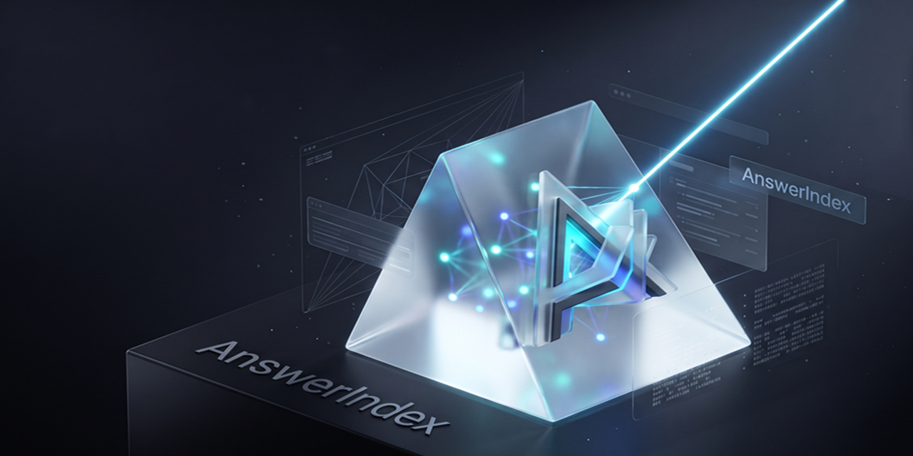

<p align="center">
  
</p>

<h1 align="center">Answer Index</h1>

<p align="center">
  <strong>Make your Content Indexable as Authoritative Answers across Search & AI Engines.</strong>
</p>

<p align="center">
  <a href="#how-it-works">How It Works</a> •
  <a href="#features">Features</a> •
  <a href="#quick-start">Quick Start</a> •
  <a href="#architecture--components">Architecture</a> •
  <a href="#license--attribution">License</a>
</p>

<p align="center">
  <a href="https://answerindex.xyz"><strong>🌐 Live Deployment: answerindex.xyz</strong></a>
</p>

<p align="center">
  
  
  
  
  
</p>

---

<p align="center">
  
</p>

---

AnswerIndex is a unified evaluation and optimization suite for **AEO (Answer Engine Optimization)**, **GEO (Generative Engine Optimization)**, and **Technical SEO**.

While traditional SEO focuses on getting crawled by search engines, **AnswerIndex** focuses on getting **cited as the definitive answer** by ChatGPT Search, Perplexity, Gemini, Claude, and Google AI Overviews.

---

## Why AnswerIndex?

When someone asks ChatGPT, Perplexity, Claude, or Gemini for a recommendation, comparison, or solution, they often receive an authoritative answer **before they ever visit a website**. If your content isn't structured for generative extraction, these models guess—and they often guess wrong or omit you entirely.

AnswerIndex bridges that gap by benchmarking how AI models actively perceive and cite your brand, auditing your site against answer-engine standards, and providing structured schemas and semantic patterns so AI assistants cite your product with complete accuracy and authority.

---

## How It Works: The 5-Phase Sequential Execution Pipeline

AnswerIndex operates via an authoritative 5-phase deliverable pipeline designed to transform raw brand content into the primary cited source across Search and AI engines:

```
Phase 1: Ingestion & Entity Graph ➔ Phase 2: Structural Schema & Technical SEO ➔ Phase 3: AEO Architecture ➔ Phase 4: GEO & RAG Chunking ➔ Phase 5: Verification & Checklist
```

1. **Phase 1: Content Extraction & Entity Modeling (Foundation):** Cleanse content corpus, extract primary Named Entities (Organizations, Products, Topics, Use Cases), and map relationships (`isA`, `solves`, `alternativeTo`) to Wikidata/Schema ontology alongside search intent categorization.
2. **Phase 2: Structural Schema & Technical SEO:** Generate valid, connected JSON-LD schemas (`TechArticle`, `FAQPage`, `SoftwareApplication`, `Organization` with `sameAs`), crawl directives, canonical definitions, and meta cards.
3. **Phase 3: Answer Engine Optimization (AEO Architecture):** Format 40–55 word direct-answer zero-click snippets for snippet parity, match exact user queries to `<h2>`/`<h3>` headings, and construct scrapeable high-density markdown tables and numbered steps.
4. **Phase 4: Generative Engine Optimization (GEO & LLM Retrieval):** Chunk content into modular 250–400 token semantic blocks with high factual density, eliminate conversational fluff/marketing adjectives, and anchor claims with quotable benchmarks.
5. **Phase 5: Verification & Delivery Checklist:** Output clean markdown with zero-click snippets, entity relationships, AEO core answers, valid `<script type="application/ld+json">`, and vector-ready chunks.

For the full operational specification, see [EXECUTION-ENGINE-SPEC.md](file:///d:/AI%20Product/answerindex/EXECUTION-ENGINE-SPEC.md).  
To remediate false citations, outdated figures, or competitor conflation across AI models, see the [ANTI-HALLUCINATION-SPEC.md](file:///d:/AI%20Product/answerindex/ANTI-HALLUCINATION-SPEC.md).

---

## Features

AnswerIndex delivers a unified, production-grade engine spanning root indexation, answer extraction, citation benchmarking, and technical SEO:

- 📦 **Automated 26-File Optimization Suite:** Generate a complete architecture of 26 production-ready files in a single pass—spanning machine-readable web-root manifests, structured entity graphs, RAG vector indexes, and diagnostic scorecards.
- 🤖 **Comprehensive AI Crawler & Agent Directives:** Explicit governance rules and permissions tailored for modern AI search engines and agents (ChatGPT/GPTBot, ClaudeBot, PerplexityBot, Google-Extended, Applebot, Cohere).
- 🧠 **OpenRouter Citation & Perception Benchmark:** Test your brand against leading foundation models via OpenRouter (e.g., Nvidia Nemotron 3.5 Lightning) to measure citation presence, factual accuracy, and hallucination risk.
- ⚡ **AEO Engine Audit & Scorecards:** Evaluate domain clarity, transparency standards, and machine-readability using automated AEO diagnostic scoring.
- 🎯 **Passage-Level GEO Citability Briefs:** Structure content into high-citability 40–60 word answer passages optimized for zero-click extraction by ChatGPT Search, Perplexity, and Google AI Overviews.
- 🗺️ **Semantic Cluster & Authority Mapping:** Interactive visual topic cluster map (`cluster-map.html`) to establish entity authority and internal linking hierarchy.
- 🛠️ **Deep Technical & Schema SEO:** Advanced modular suite for Schema.org JSON-LD graph generation, XML sitemaps, Core Web Vitals, and crawl hygiene.
- 🔌 **Native Model Context Protocol (MCP) Server:** Connect AnswerIndex directly into AI coding environments like Cursor, Claude Code, Windsurf, or VS Code over stdio.
- 💻 **Universal Automation:** Portable CLI and modular script runners for seamless integration into CI/CD pipelines or local terminal workflows.

---

## The 26-File AnswerIndex Architecture

When you run `npm run ready yourdomain.com "Your Brand"`, AnswerIndex generates a complete, tailored suite of **26 production files** into `./ai-readiness-dist/yourdomain.com/`:

### 1. Web-Root Identity, Content & Knowledge Manifests (Deploy to Web Root)
These files deploy directly to your website's public web root (`public/` or server root) to ensure search engines and AI assistants discover, understand, and cite your canonical content:

| Category | File | Description & Role |
|---|---|---|
| **Identity & Access** | `robots.txt` | Governs crawler access with explicit permissions for ChatGPT, Claude, Perplexity, Google AI, and Applebot. |
| | `ai.txt` | Standard machine-readable transparency declaration, contact info, and citation permissions. |
| **Content Extraction** | `llms.txt` | Concise, markdown-formatted site overview and canonical paths per the [llmstxt.org](https://llmstxt.org) standard. |
| | `llms-full.txt` | Complete un-truncated documentation text corpus designed for large LLM context injection. |
| **Site Navigation** | `sitemap.md` | Human- & LLM-readable markdown sitemap for clean architectural reasoning and link exploration. |
| | `ai-sitemap.xml` | Priority XML sitemap built explicitly for AI indexing crawlers. |
| **Semantic Intelligence** | `ai-entities.json` | Machine-readable entity graph, core taxonomy, and verified brand claims. |
| | `ai-intent.json` | Maps natural language user questions directly to authoritative destination URLs. |
| | `ai-schema.json` | Consolidated Schema.org JSON-LD graph (`WebSite`, `Organization`). |
| **RAG & Vector Retrieval** | `rag-index.json` | Vector search index with importance-weighted knowledge chunks for retrieval pipelines. |
| | `rag-index.jsonl` | Line-delimited JSON format for batch embedding and vector database ingestion. |
| **Policies & Integration** | `training-data-policy.txt` | Transparent fair-use guidelines for citation versus model training. |
| | `ai-disclosure.txt` | Formal AI integration and AEO compliance disclosure statement. |
| | `.well-known/ai-plugin.json` | Standard plugin manifest registering your site as an official AI resource endpoint. |
| **Deployment & Ops** | `manifest.json` | Master inventory and compliance scorecard for your deployed files. |
| | `structured-data-guide.md` | Practical guide for embedding high-citation JSON-LD schemas in your HTML templates. |
| | `deployment-checklist.md` | Pre- and post-deployment checklist for engineering and web teams. |
| | `README.md` | Quick deployment instructions for your web server. |

### 2. AEO Diagnostics, GEO Briefs & Schema Suite (Auditing & Content Strategy)
Optimization, benchmarking, and structured-data assets generated for your content, SEO, and engineering teams:

| Artifact | Type | Description & Role |
|---|---|---|
| `aeo-audit-scorecard.json` | Diagnostic | Automated scoring across machine readability, entity clarity, and citation readiness. |
| `ai-citation-benchmark.json` | Benchmark Config | Live evaluation metrics across top foundation models via OpenRouter. |
| `geo-content-brief.md` | Content Strategy | Passage-level citability rules (40–60 word blocks) for ChatGPT Search and Perplexity. |
| `cluster-map.html` | Visual Architecture | Interactive HTML semantic topic cluster map showing hubs and spoke authority flows. |
| `technical-seo-audit.json` | Technical Audit | Crawl evaluation covering SSL, canonicals, robots directives, and responsiveness. |
| `jsonld-schema-templates.json` | Schema Suite | Production-ready Schema.org templates (`WebApplication`, `Organization`, `FAQPage`). |
| `schema-validation-report.md` | Compliance | Rich-result compliance report evaluating structured data against Google and AI search standards. |
| `ai-answer-passages.md` | Direct Answers | Pre-packaged high-citation Q&A passages designed for zero-click AI snippet extraction. |

---

## MCP Server Integration (Cursor, Claude Code, Windsurf)

AnswerIndex includes a built-in **Model Context Protocol (MCP)** server so you can generate the complete file suite and inspect AI crawler specifications directly inside your coding agents.

### Cursor Setup
Add to `.cursor/mcp.json`:
```json
{
  "mcpServers": {
    "answerindex": {
      "command": "node",
      "args": ["d:/AI Product/answerindex/lib/mcp-server.mjs"]
    }
  }
}
```

### Claude Code Setup
Add to `.mcp.json` in your workspace:
```json
{
  "mcpServers": {
    "answerindex": {
      "command": "node",
      "args": ["./lib/mcp-server.mjs"]
    }
  }
}
```
Available tools in MCP:
- `generate_ai_readiness_kit`: Generate the full 26-file AnswerIndex suite for any domain.
- `list_ai_crawlers`: Review major AI bots, permissions, and indexing purposes.
- `get_llms_txt_spec`: Retrieve the official specification for `llms.txt` and `ai.txt`.

---

## Quick Start

### 1. Installation

```bash
git clone https://github.com/justmailsameer-prog/answerindex.git
cd answerindex
npm install
```

### 2. Configure Environment

Copy `.env.example` to `.env` and add a single [OpenRouter API key](https://openrouter.ai/keys) to run benchmarks:

**macOS / Linux:**
```bash
cp .env.example .env
```

**Windows (PowerShell):**
```powershell
Copy-Item .env.example .env
```

Edit `.env`:
```dotenv
OPENROUTER_API_KEY=sk-or-v1-your_openrouter_api_key_here
```

### 3. Usage (Generic for Any Brand / Website)

```bash
# 1. Generate the complete 26-file AI Readiness suite for your website
npm run ready yourbrand.com "Your Brand Name"

# 2. Run multi-model foundation citation benchmark across AI engines
npm run benchmark -- yourbrand.com "Your Brand Name"

# 3. Run automated AEO domain assessment
npm run aeo yourbrand.com

# 4. Run deep technical & schema SEO audit
npm run seo

# 5. Start Model Context Protocol (MCP) server for AI coding assistants
npm run mcp
```

Or run via the unified CLI directly:

```bash
node bin/answerindex.mjs ready yourbrand.com "Your Brand Name"
node bin/answerindex.mjs benchmark yourbrand.com "Your Brand Name"
node bin/answerindex.mjs aeo yourbrand.com
node bin/answerindex.mjs seo
node bin/answerindex.mjs mcp
```

---

## Troubleshooting & FAQ

#### 1. "no .env.example file available"
Ensure you are using the latest version of the repository. `.env.example` is tracked in git. Copy it using `cp .env.example .env` (or `Copy-Item .env.example .env` in PowerShell).

#### 2. Benchmark defaults or missing arguments
Always pass your domain and brand name using the `--` separator with npm:
```bash
npm run benchmark -- yourbrand.com "Your Brand Name"
```
Or use the CLI directly:
```bash
node bin/answerindex.mjs benchmark yourbrand.com "Your Brand Name"
```

#### 3. Missing Python dependencies (`ModuleNotFoundError: No module named 'bs4'`)
The deep SEO toolkit requires Python 3.10+. Install the required packages with:
```bash
python -m pip install -r seo-toolkit/requirements.txt
```

#### 4. `npm run mcp` hangs or stays open
This is expected behavior! The AnswerIndex MCP server uses standard input/output (`stdio`) JSON-RPC 2.0 to communicate with AI coding assistants (Cursor, Claude Code, Windsurf). It is not meant to be run as an interactive human terminal command. Instead, add it to your client's MCP configuration as described in the [Model Context Protocol (MCP) Integration](#model-context-protocol-mcp-integration) section.

---

## Architecture & Components

| Component | Role | Description |
|-----------|------|-------------|
| `bin/answerindex.mjs` | Unified CLI | Command-line entry point (`ready`, `benchmark`, `aeo`, `seo`, `mcp`) |
| `lib/readiness-generator.mjs` | AI Readiness Engine | Generates `llms.txt`, `ai.txt`, `robots.txt`, schemas, entity & intent graphs |
| `lib/mcp-server.mjs` | MCP Server | Standard Model Context Protocol server for Cursor & Claude Code |
| `test-aeo-models.mjs` | Citation Benchmark | OpenRouter model citation and entity recognition benchmark |
| `seo-toolkit/` | Technical & Schema SEO | 24+ specialized SEO & GEO skill modules |
| `run-*.sh` | Script Runners | Portable runners for cross-platform automation |

---

## Disclaimer, Terms & License

### Disclaimer & Terms of Use

- **Automated Platform Activity & Policies:** All AI platforms (OpenAI, Anthropic, Perplexity, Google, etc.) maintain specific policies regarding automated activity, scraping, crawler directives, and API usage. It is your sole responsibility to review and comply with all applicable third-party terms of service and acceptable use policies before using this tool or deploying its generated manifests with your domain or accounts.
- **No Warranties or Guarantees:** This program is provided "as-is", without any warranties or guarantees of any kind, whether express or implied. The accuracy, reliability, and effectiveness of the program, AI citation benchmarks, and generated schemas cannot be guaranteed. Use it at your own risk.
- **Disclaimer of Liability:** The creators and contributors of this program shall not be held responsible or liable for any damages, penalties, or consequences arising from the direct or indirect use, interaction, or actions performed with this program. This includes but is not limited to any legal issues, loss of data, search engine de-indexing, crawler blocks, or other operational damages incurred.
- **Use at Your Own Risk:** It is important to exercise caution and ensure that your usage, interactions, and actions with this program comply with all applicable local and international laws, regulations, and the terms of the services you interact with.

### License & Copyright

Copyright (c) 2026 Sameer Sharma. Licensed under the MIT License — see (LICENSE).
